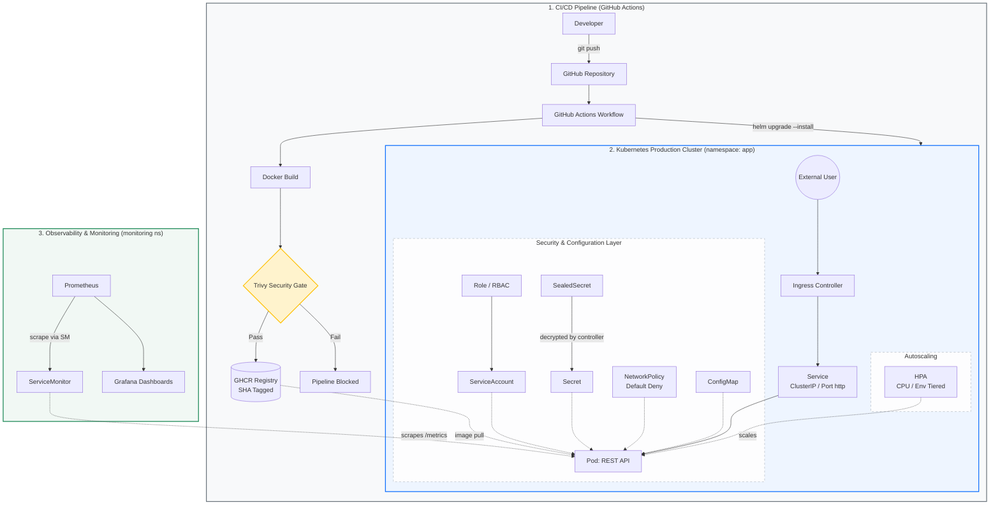

# 🚀 DevOps K8s Pipeline

> **Production-grade Kubernetes deployment pipeline** for a Node.js REST API — multi-stage Docker builds, Sealed Secrets, RBAC, NetworkPolicy, HPA, Helm, Prometheus/Grafana observability, and GitHub Actions CI/CD with vulnerability scanning, all deployed and verified on a live cluster.

[](https://github.com/devscale-ds-tn/devops-k8s-pipeline/actions)
[](LICENSE)
[](https://nodejs.org/)
[](https://kubernetes.io/)
[](https://docker.com/)
[](https://helm.sh/)
[](https://aquasecurity.github.io/trivy/)
[](https://prometheus.io/)

---

## 📋 Table of Contents

- [🎯 Overview](#-overview)
- [✨ Features](#-features)
- [🏗️ Architecture](#️-architecture)
- [📁 Repository Structure](#-repository-structure)
- [🚀 Quick Start](#-quick-start)
- [☸️ Kubernetes Manifests](#️-kubernetes-manifests)
- [🔐 Security Design](#-security-design)
- [🔒 Sealed Secrets Workflow](#-sealed-secrets-workflow)
- [🛡️ RBAC](#️-rbac)
- [📈 HPA & metrics-server](#-hpa--metrics-server)
- [📦 Helm Chart](#-helm-chart)
- [⚙️ CI/CD Pipeline](#️-ci-cd-pipeline)
- [🔍 Vulnerability Scanning (Trivy)](#-vulnerability-scanning-trivy)
- [📊 Observability (Prometheus + Grafana)](#-observability-prometheus--grafana)
- [🐛 Troubleshooting](#-troubleshooting)
- [🛠️ Tech Stack](#️-tech-stack)
- [🤝 Contributing](#-contributing)
- [📄 License](#-license)

---

## 🎯 Overview

This is a **complete, production-ready DevOps pipeline** that takes a Node.js REST API from code to a live Kubernetes cluster. Every layer is designed for security, scalability, and observability:

- **Multi-stage Docker builds** — small, non-root runtime images
- **GitHub Actions CI/CD** — build → Trivy scan → push to GHCR → manual deploy gate
- **Sealed Secrets** — encrypted credentials safe to commit to a public repo
- **RBAC + NetworkPolicy** — least-privilege access, default-deny networking
- **Horizontal Pod Autoscaler (HPA)** — environment-tiered autoscaling
- **Prometheus + Grafana** — full observability with custom app metrics
- **ServiceMonitor** — automated Prometheus scraping via `prom-client` instrumentation

---

## ✨ Features

| Feature | Description |
|---------|-------------|
| 🐳 **Multi-stage Docker** | Build stage deps, runtime stage only what's needed; non-root user |
| 🔄 **GitHub Actions CI/CD** | Build, scan, push on every push; manual deploy gate via `workflow_dispatch` |
| 🛡️ **Trivy Scanning** | Fails closed on HIGH/CRITICAL CVEs — no image deploys unless clean |
| 🔐 **Sealed Secrets** | Client-side encrypted secrets, decrypted only in-cluster |
| 🔒 **RBAC** | Dedicated ServiceAccount, least-privilege Role, no token automount |
| 🚫 **NetworkPolicy** | Default-deny ingress, explicit allow only from ingress-nginx |
| 📈 **HPA** | CPU-based autoscaling, tiered bounds per environment (dev/prod) |
| 📊 **Observability** | Prometheus + Grafana, custom app metrics via `prom-client` |
| ☸️ **Helm** | Full Helm chart with dev/prod overrides, namespace pre-create hook |

---

## 🏗️ Architecture

> Rendered as Mermaid rather than a static PNG, GitHub renders it natively, and it stays in sync with the repo instead of going stale as a binary asset.



## 📁 Repository Structure

```
devops-k8s-pipeline/
├── src/                          # Node.js REST API source
│   ├── index.js
│   ├── index.test.js
│   └── metrics.js                # prom-client instrumentation (counter + histogram)
├── Dockerfile                    # Multi-stage, non-root build
├── k8s/                          # Raw Kubernetes manifests
│   ├── namespace.yaml
│   ├── deployment.yaml
│   ├── service.yaml
│   ├── configmap.yaml
│   ├── hpa.yaml
│   ├── ingress.yaml
│   ├── networkpolicy.yaml
│   ├── serviceaccount.yaml
│   ├── role.yaml
│   ├── rolebinding.yaml
│   └── sealedsecret.yaml
├── helm/
│   └── app-chart/
│       ├── Chart.yaml
│       ├── values.yaml           # defaults / production-tier documentation
│       ├── values-dev.yaml       # dev overrides (lighter HPA + resource bounds)
│       ├── values-prod.yaml      # prod overrides (heavier HPA + resource bounds)
│       └── templates/
│           ├── namespace.yaml
│           ├── deployment.yaml
│           ├── service.yaml
│           ├── configmap.yaml
│           ├── hpa.yaml
│           ├── ingress.yaml
│           ├── networkpolicy.yaml
│           ├── serviceaccount.yaml
│           ├── role.yaml
│           ├── rolebinding.yaml
│           ├── servicemonitor.yaml   # Prometheus scrape target
│           └── _helpers.tpl
├── .github/
│   ├── workflows/
│   │   └── build-push-deploy.yaml
│   └── dependabot.yml
└── docs/
    └── screenshots/
```

## Kubernetes Manifests

| File                             | Purpose                                           | Key detail                                                                                                                                                 |
| -------------------------------- | ------------------------------------------------- | ---------------------------------------------------------------------------------------------------------------------------------------------------------- |
| `namespace.yaml`                 | Isolates all app resources in the `app` namespace | Also templated in the Helm chart, see [Helm Chart](#helm-chart) for the namespace-adoption pattern this requires                                           |
| `deployment.yaml`                | Runs the REST API pods                            | Rolling update strategy: `maxSurge: 1`, `maxUnavailable: 0`, zero downtime during rollouts; requests/limits set so the scheduler and HPA can both function |
| `service.yaml`                   | Stable internal DNS + load balancing to pods      | `ClusterIP`, internal only, exposed externally via Ingress; port is explicitly **named** (`http`) so the `ServiceMonitor` can target it                    |
| `configmap.yaml`                 | Non-secret app configuration                      | Consumed via `envFrom`                                                                                                                                     |
| `hpa.yaml`                       | Autoscaling                                       | Bounds and CPU target are tiered per environment, see [HPA & metrics-server](#hpa--metrics-server)                                                         |
| `ingress.yaml`                   | External HTTP routing into the cluster            | Routes to the `service.yaml` ClusterIP                                                                                                                     |
| `networkpolicy.yaml`             | Restricts which traffic can reach the pod         | Default-deny ingress, explicit allow only from the `ingress-nginx` namespace via `namespaceSelector`                                                       |
| `serviceaccount.yaml`            | Dedicated pod identity                            | Named, not `default`, `automountServiceAccountToken: false` since the app never calls the Kubernetes API                                                   |
| `role.yaml` / `rolebinding.yaml` | Least-privilege RBAC                              | Scoped to the `app` namespace only                                                                                                                         |
| `sealedsecret.yaml`              | Encrypted credential delivery                     | Safe to commit, decrypted only by the in-cluster Sealed Secrets controller                                                                                 |
| `servicemonitor.yaml`            | Tells Prometheus what to scrape                   | Selector must match the Service's own labels exactly; targets the Service's named `http` port, not a raw port number                                       |

## Security Design

- No static credentials anywhere in CI, GHCR push uses `GITHUB_TOKEN`, a token GitHub generates and scopes automatically per workflow run, not a long-lived PAT.
- Containers run as a non-root user.
- Secrets are never committed in plaintext, only Sealed Secrets ciphertext.
- Default-deny NetworkPolicy, every pod is isolated unless explicitly allowed.
- Dedicated ServiceAccount per app, least-privilege Role, no reliance on the `default` ServiceAccount.
- Every image is scanned for HIGH/CRITICAL CVEs before it can be deployed, the pipeline fails closed, not open.

## Sealed Secrets Workflow

Why: a Kubernetes `Secret` is base64-encoded, not encrypted, anyone with `kubectl get secret -o yaml` or repo access can decode it in one command. Sealed Secrets solves this by encrypting the Secret client-side, so only the in-cluster controller (holding the private key) can decrypt it.

```bash
# 1. Create the plain secret ONLY in /tmp, never in the repo
kubectl create secret generic app-secret \
  --from-literal=DB_PASSWORD='<value>' \
  --dry-run=client -o yaml > /tmp/secret.yaml

# 2. Seal it using the controller's public key
kubeseal --format=yaml < /tmp/secret.yaml > k8s/sealedsecret.yaml

# 3. Delete the plaintext file immediately
rm /tmp/secret.yaml

# 4. Commit only the sealed (encrypted) version
git add k8s/sealedsecret.yaml
git commit -m "feat: add Sealed Secrets"
git push

# 5. Verify the plaintext secret never touched git history
git log --all --full-history -- k8s/secret.yaml
# → returns nothing
```

The `SealedSecret` object is safe in a public repo: without the controller's private key (which never leaves the cluster), the ciphertext is useless. On apply, the controller decrypts it into a normal Kubernetes `Secret` inside the cluster only.

## RBAC

- `serviceaccount.yaml`, a named ServiceAccount, not the namespace's `default` one.
- `role.yaml`, the absolute minimum verbs the app needs. This app doesn't call the Kubernetes API at all (config arrives via `envFrom`/mounted volumes), so the Role is intentionally close to empty, a deliberate design decision, not an oversight.
- `rolebinding.yaml`, scoped to the `app` namespace, capping the Role's reach even if it were broader.
- `automountServiceAccountToken: false` on the pod spec, since the app has no legitimate reason to talk to the API server, it doesn't get a credential capable of doing so, which closes off a lateral-movement path if the container is ever compromised.

## HPA & metrics-server

HPA needs real CPU metrics to scale, and those metrics come from `metrics-server`, not from Kubernetes itself. On minikube, `metrics-server` doesn't work out of the box because it can't verify the kubelet's self-signed TLS certificate, this shows up as `kubectl describe hpa` reporting `<unknown>` instead of a percentage.

```bash
minikube addons enable metrics-server

kubectl patch deployment metrics-server -n kube-system --type='json' \
  -p='[{"op":"add","path":"/spec/template/spec/containers/0/args/-","value":"--kubelet-insecure-tls"}]'

kubectl rollout status deployment/metrics-server -n kube-system
```

One real gotcha hit while building this: re-running the patch command more than once (while debugging an unrelated issue) appended `--kubelet-insecure-tls` to the args array four times over, since a JSON-patch `add` operation always appends rather than checking for an existing value. Cleaned up with a single `op: replace` supplying the full, deduplicated args array in one shot, `add` and `replace` are not interchangeable for idempotent patching.

**Bounds are tiered per environment**, not fixed. `values.yaml` documents the production design (min 2 / max 5, 70% CPU target); `values-dev.yaml` overrides to a lighter min 1 / max 2 to fit a resource-constrained local minikube VM; `values-prod.yaml` overrides to min 3 / max 10 at a 60% target. A `kubectl get hpa` on a local dev deploy correctly shows the dev-tier bounds, not the production ones documented at the top level, this is intentional environment-scoping, not drift between the docs and the cluster.

Verified end state:

```bash
kubectl describe hpa -n app
# → cpu: <real number>%/<target>% (real number, not <unknown>)

curl localhost:3000/health
# → {"status":"ok"}
```

## Helm Chart

```
helm/app-chart/
├── Chart.yaml
├── values.yaml           # defaults
├── values-dev.yaml       # dev overrides only
├── values-prod.yaml      # prod overrides only
└── templates/
    ├── namespace.yaml
    ├── deployment.yaml
    ├── service.yaml
    ├── configmap.yaml
    ├── hpa.yaml
    ├── ingress.yaml
    ├── networkpolicy.yaml
    ├── serviceaccount.yaml
    ├── role.yaml
    ├── rolebinding.yaml
    ├── servicemonitor.yaml
    └── _helpers.tpl
```

`helm lint` clean, `helm template` produces valid YAML for every manifest.

**Namespace adoption pattern (real issue, not theoretical, now fixed with a hook):** this chart templates its own `Namespace` resource. Submitting every chart resource in one batch, as Helm normally does, can hit a race: the Namespace create call returns before the API server has finished registering it, and the very next resource-creation call in the same batch fails with `namespaces "app" not found`, even though the chart is completely valid. `--create-namespace` doesn't fix this; it creates a second, untracked namespace that then collides with the chart's own templated one.

Fixed by annotating the Namespace as a Helm hook, in `helm/app-chart/templates/namespace.yaml`:

```yaml
apiVersion: v1
kind: Namespace
metadata:
  name: { { .Values.namespace } }
  annotations:
    'helm.sh/hook': pre-install
    'helm.sh/hook-weight': '-5'
```

`pre-install` runs the Namespace as its own phase _before_ the rest of the chart's resources are submitted, and Helm blocks until that phase completes, which is exactly the wait that closes the race. Deliberately scoped to `pre-install` only, not `pre-upgrade`: once the namespace exists, later `helm upgrade` runs skip this phase entirely, so there's no "already exists" conflict on every subsequent deploy. No `hook-delete-policy` is set, since deleting the Namespace would cascade-delete everything inside it, `helm uninstall` still tears the whole release down normally.

Verified on a genuinely fresh cluster (`minikube delete && minikube start`, no manual `kubectl create namespace` beforehand): `helm install` succeeded on the first attempt, no race error.

**Bootstrap order matters on a fresh cluster.** `ServiceMonitor` is a Custom Resource Definition installed by the Prometheus Operator, not a built-in Kubernetes kind, installing this app chart before `kube-prometheus-stack` fails with `no matches for kind "ServiceMonitor" in version "monitoring.coreos.com/v1"`, since the CRD simply doesn't exist yet. The monitoring stack must be installed first. See [Local Deployment](#local-deployment-minikube) for the corrected order.

**Always pass `--namespace` explicitly on `helm install`/`helm upgrade`.** Each manifest in this chart sets its own `metadata.namespace` via `{{ .Values.namespace }}`, but that's independent of which namespace _Helm's own release bookkeeping_ uses, without an explicit `--namespace` flag, Helm records the release under whatever namespace your current `kubectl` context defaults to (often `default`), even while the actual pods land correctly in `app`. The split is silent: `kubectl get pods -n app` looks fine, but `helm list` and future `helm upgrade`/`helm uninstall` calls against the wrong namespace fail or operate on nothing.

**ServiceMonitor wiring:** a `ServiceMonitor`'s `selector.matchLabels` must match the target `Service`'s labels exactly, and its `endpoints[].port` refers to a **named** Service port (`name: http`), not a bare port number, a Service with an unnamed port gives the ServiceMonitor nothing to resolve, even with a perfectly correct selector. Confirmed working via Prometheus's own target list (`serviceMonitor/app/api/0`, state `UP`).

## CI/CD Pipeline

`.github/workflows/build-push-deploy.yaml`, two jobs, two different triggers:

**`build`**, runs automatically on every push to `main`:

1. Checkout code
2. Log in to GHCR using `GITHUB_TOKEN`, a token GitHub auto-generates per workflow run, scoped by the `permissions:` block (`packages: write` here), and never stored as a long-lived secret. No PAT, no static credential.
3. Build the Docker image
4. **Trivy scan**, pipeline fails closed if HIGH/CRITICAL CVEs are found (see below)
5. Push the image to GHCR tagged with `${{ github.sha }}` (the full 40-character commit SHA), never `latest`

**`deploy`**, runs only on manual `workflow_dispatch`, never automatically on push:

6. Configure kubeconfig from a `KUBE_CONFIG_DATA` secret
7. Pre-create and Helm-adopt the target namespace (see the [Helm Chart](#helm-chart) namespace-adoption pattern)
8. `helm upgrade --install ... --set image.tag=${{ github.sha }}`

**Why deploy is gated, not automatic:** GitHub-hosted runners have no reachable Kubernetes cluster by default. A `deploy` job wired into the same trigger as `build` would fail on every single push, not intermittently, structurally, since there's nothing for `helm upgrade` to connect to. Rather than leave a job in the pipeline that can never succeed as designed, `deploy` only runs on an explicit `workflow_dispatch`, against a cluster whose kubeconfig is supplied as a secret. This also mirrors how most real deploy pipelines work: build/test/scan on every commit, deploy behind an explicit gate, not blind auto-deploy on every merge.

**Why SHA tags, not `latest`:** every image is traceable to the exact commit that produced it, and a rollback is just redeploying a known-good SHA, no ambiguity about what `latest` currently points to. The tag is the **full** SHA (`${{ github.sha }}`), not the short 7-character form `git log --format=%h` prints, a manual local deploy has to use the full SHA or it will fail with `manifest unknown` against a tag that was never actually pushed. The tradeoff: `values.yaml`'s dev default of `image.tag: latest` is intentional for local development, but since the pipeline only ever publishes SHA tags, a bare `helm install` without an explicit `--set image.tag=<full-sha>` override will fail. That's expected behavior, not a bug, see [Local Deployment](#local-deployment-minikube).

## Vulnerability Scanning (Trivy)

```yaml
- name: Scan image for vulnerabilities
  run: |
    docker run --rm aquasec/trivy image \
      --exit-code 1 \
      --severity HIGH,CRITICAL \
      ${{ env.REGISTRY }}/${{ env.IMAGE_NAME }}:${{ github.sha }}
```

`--exit-code 1` means the pipeline fails the build if any HIGH or CRITICAL CVE is found, vulnerabilities block the release rather than being logged and ignored.

Real findings from the first scan: **13 HIGH vulnerabilities.**

- **2** in Alpine OS packages (`libcrypto3`, `libssl3`), fixed with `apk update && apk upgrade --no-cache` in the runtime stage.
- **11** traced to the npm CLI's own bundled dependency tree, not anything in this project's `package.json`. Since the container's `CMD` calls `node` directly and never invokes `npm`/`npx` at runtime, those binaries (and their vulnerable dependencies) were removed from the runtime image entirely rather than chasing unfixable upstream overrides.

Re-scan after the fix: **0 HIGH/CRITICAL.**

## Dependency Updates (Dependabot)

`.github/dependabot.yml` watches two ecosystems on a weekly schedule: `npm` (application dependencies) and `github-actions` (workflow action versions), kept as separate entries since they're different ecosystems with different update cadences and risk profiles.

## Observability (Prometheus + Grafana)

`kube-prometheus-stack` installed via Helm into a separate `monitoring` namespace, configured to watch every `ServiceMonitor` cluster-wide (`serviceMonitorSelectorNilUsesHelmValues=false`) rather than only ones labeled for its own release, since the app's `ServiceMonitor` lives in a different namespace under different labels.

```bash
helm repo add prometheus-community https://prometheus-community.github.io/helm-charts
helm repo update

helm install monitoring prometheus-community/kube-prometheus-stack \
  --namespace monitoring \
  --create-namespace \
  --set prometheus.prometheusSpec.serviceMonitorSelectorNilUsesHelmValues=false
```

### App instrumentation

`src/metrics.js` uses `prom-client` to expose two custom metrics plus Node's default process metrics, all served from a `/metrics` endpoint:

- `http_requests_total` — a Counter, labeled by `method`, `route`, `status_code`. Powers request-rate queries via `rate()`.
- `http_request_duration_seconds` — a Histogram with latency buckets, powers percentile queries via `histogram_quantile()`.
- `collectDefaultMetrics()` — free process-level CPU/memory/event-loop metrics, no extra code needed.

Both custom metrics are recorded inside a `res.on('finish', ...)` handler, not before calling `next()`, `finish` only fires once the response is actually sent, so `res.statusCode` reflects the real final status even if a downstream handler changes it. Recording earlier would mislabel every request as its initial status code.

### ServiceMonitor

```yaml
apiVersion: monitoring.coreos.com/v1
kind: ServiceMonitor
metadata:
  name: api
  namespace: { { .Values.namespace } }
spec:
  selector:
    matchLabels:
      app: api
  namespaceSelector:
    matchNames:
      - { { .Values.namespace } }
  endpoints:
    - port: http
      path: /metrics
      interval: 15s
```

**Gotcha:** `endpoints[].port: http` refers to a Service port by **name**, not by number, the Service manifest needed an explicit `name: http` added to its port definition before this could resolve to anything, even with a correct label selector. Verified in Prometheus's own target list: `serviceMonitor/app/api/0`, state `UP`, real scrapes every 15s.

### Dashboards

- **Cluster-level:** no custom dashboards built, `kube-prometheus-stack`'s Grafana sidecar ships the full `kubernetes-mixin` and `node-exporter-mixin` dashboard sets by default (`Compute Resources / Cluster`, `/ Namespace (Pods)`, `/ Pod`, `/ Node (Pods)`, `Node Exporter / Nodes`, etc.). Confirmed showing real, live CPU/memory numbers against the actual running `api` pod, these are the "community dashboards" the observability design called for, pre-wired rather than manually imported.
- **App-level:** a custom "App Metrics" dashboard with two panels, built against the custom metrics above:
  - Request rate by route: `sum(rate(http_requests_total[5m])) by (route)`
  - p95 latency by route: `histogram_quantile(0.95, sum(rate(http_request_duration_seconds_bucket[5m])) by (le, route))`

Screenshots: [`docs/screenshots/`](docs/screenshots)

## Local Deployment (Minikube)

**Order matters:** the observability stack must go in before the app chart, the app chart's `ServiceMonitor` resource is a Custom Resource that doesn't exist until `kube-prometheus-stack`'s CRDs are installed. Verified end to end on a genuinely fresh cluster (`minikube delete && minikube start`, no pre-existing state).

```bash
minikube start
minikube addons enable ingress
minikube addons enable metrics-server

kubectl patch deployment metrics-server -n kube-system --type='json' \
  -p='[{"op":"add","path":"/spec/template/spec/containers/0/args/-","value":"--kubelet-insecure-tls"}]'
kubectl rollout status deployment/metrics-server -n kube-system

# 1. Observability stack FIRST, installs the ServiceMonitor CRD the app chart depends on
helm install monitoring prometheus-community/kube-prometheus-stack \
  --namespace monitoring \
  --create-namespace \
  --set prometheus.prometheusSpec.serviceMonitorSelectorNilUsesHelmValues=false

# 2. App chart, no manual namespace pre-create needed, the chart's pre-install hook
#    handles it (see Helm Chart section above). --namespace is always explicit,
#    since Helm's own release bookkeeping is independent of the chart's templated
#    resource namespaces.
helm install app ./helm/app-chart \
  -f helm/app-chart/values-dev.yaml \
  --namespace app \
  --set image.tag=<actual-full-sha-from-ghcr>

# Pod readiness is scripted with kubectl wait, not a fixed sleep,
# to avoid racing a port-forward or curl against a not-yet-Ready pod
kubectl wait --for=condition=ready pod -l app=api -n app --timeout=60s
```

Verify:

```bash
kubectl get pods -n app
# → Running 1/1

kubectl describe hpa -n app
# → cpu: <real>%/<target>%

curl localhost:3000/health
# → {"status":"ok"}

curl localhost:3000/metrics | grep http_requests_total
# → real counter lines, not empty
```

Screenshots of the verified deployment: [`docs/screenshots/`](docs/screenshots)

## What I Learned

- **Layer cache order matters more than it looks.** Copying `package*.json` before the rest of the source (before `npm ci`) means Docker only reinstalls dependencies when they actually change, not on every single source edit.
- **NetworkPolicy is additive, not exclusive.** The moment any policy selects a pod, all unlisted traffic is denied by default, multiple policies stack their allow-rules rather than overriding each other, which is easy to get backwards under pressure.
- **A syntactically valid Helm chart can still fail on a fresh cluster.** The namespace-registration race between Helm's Namespace creation and its next resource call isn't a chart bug, it's an API-server timing issue, and the fix (pre-create + ownership-annotation adoption) is a pattern worth reusing on any chart that templates its own Namespace.
- **SHA tags vs `latest` is a deliberate tradeoff, not a default to "fix."** The instinct when `manifest unknown` shows up is to make `latest` exist. The correct fix was the opposite: keep the SHA-only publishing design for traceability, and make the deploy command specify the tag explicitly, and specifically the **full** SHA, since `${{ github.sha }}` in Actions never matches the short 7-character form.
- **A commit that was never actually pushed produces the exact same symptom as a tag-format mismatch.** Chased `manifest unknown` down two different wrong paths (short vs full SHA) before checking `git log -1 --oneline` against `origin/main` and discovering the real commit had simply never reached the remote. The lesson: verify the commit is actually on GitHub before debugging the deploy command at all.
- **Vulnerability scanning the built image catches things `npm audit` never will.** 11 of 13 HIGH findings were in the npm CLI's own bundled dependencies, completely invisible to `npm audit`, which only looks at `package.json`'s tree, and they were unused at runtime entirely, so the real fix was removing the binary, not patching it.
- **`kubectl patch` with `op: add` is not idempotent.** Re-running the same JSON-patch add operation multiple times appends duplicate array entries instead of no-op'ing, `op: replace` with the full desired array is the safe way to apply the same patch more than once.
- **A CI job that can never succeed in its runner environment is worse than no job at all.** The `deploy` job was originally wired to run on every push despite GitHub-hosted runners having no reachable cluster, guaranteed to fail every single time, for reasons that had nothing to do with the code being deployed. Gating it behind `workflow_dispatch` turned a permanently-red job into an accurate signal: automatic CI now reports what's actually true (build, scan, and push all succeed), and deploy is a deliberate, on-demand action instead of a job destined to fail by design.
- **A ServiceMonitor's selector and port reference are both silent failure points.** A label mismatch or an unnamed Service port doesn't throw an error anywhere, Prometheus just never lists the target at all. Confirming a real `UP` state in Prometheus's own target list is the only reliable verification, not just "the YAML applied cleanly."
- **HPA bounds should be environment-tiered, not fixed.** What looked like a documentation/reality mismatch (2/5 documented vs 1/2 observed) was actually correct: production-tier bounds live in the base `values.yaml`, and `values-dev.yaml` intentionally overrides to lighter bounds for a resource-constrained local cluster. Worth stating explicitly in docs so it reads as design, not drift.
- **A manual fix that "works" can hide a bootstrap-order dependency.** The namespace pre-create workaround had been run enough times on a cluster that already had the monitoring CRDs installed that the real install-order dependency (`ServiceMonitor` requires `kube-prometheus-stack`'s CRDs to exist first) never surfaced until testing on a genuinely fresh cluster. Converting the workaround into a `pre-install` Helm hook, and only then re-testing from zero state, is what exposed it, a reminder that a working manual fix isn't the same as a correct, reproducible bootstrap sequence.
- **Helm's release namespace and a chart's templated resource namespace are two independent things.** Omitting `--namespace` on `helm install` doesn't fail loudly, it silently records the release under `kubectl`'s current-context default namespace while the actual pods land wherever the chart's `{{ .Values.namespace }}` says. `kubectl get pods` looks completely normal; `helm list`/`helm upgrade`/`helm uninstall` against the namespace you assumed is what breaks, later, confusingly. Always pass `--namespace` explicitly.
- **`kubectl wait --for=condition=ready` beats a fixed `sleep` for scripting around pod startup.** A `sleep N` before `curl`ing a freshly-deployed pod is a guess; `kubectl wait` blocks until the pod is actually `Ready` (or fails loudly on a real timeout), which is what a CI script or a demo should rely on instead of a guessed delay.

## Tech Stack

Node.js · Express · Docker · Kubernetes · Helm · Sealed Secrets · RBAC · NetworkPolicy · HPA · Prometheus · Grafana · prom-client · GitHub Actions · Trivy · Dependabot · minikube

## License

MIT
